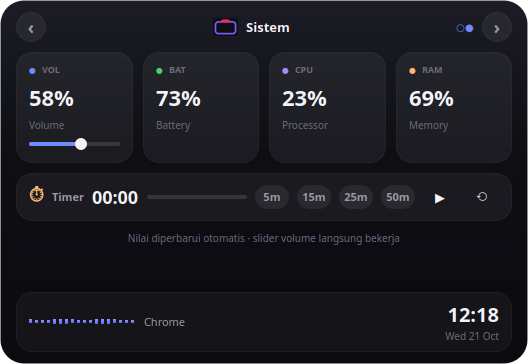

# notchy — Dynamic Island untuk Linux & Windows

Aplikasi overlay top-center ala Dynamic Island, diport dari mekanisme
**boring.notch v2.7.3** (aplikasi notch untuk MacBook) lewat analisis reverse-
engineering pada binary shipped-nya. Visual mengikuti bahasa desain
**glass bento ala Alcove** — pill mungil saat idle, panel kaca gelap berisi
kartu musik + bento tiles + waveform saat dibuka, lengkap dengan thumbnail
album art asli dari pemutar.




## Dukungan OS

| | Linux | Windows 10/11 |
|---|---|---|
| UI / overlay | Qt (X11/Xwayland) | Qt (native, stay-on-top) |
| Now Playing | **MPRIS** (D-Bus) | **SMTC** (`winsdk` — Windows.Media.Control) |
| Thumbnail album | `mpris:artUrl` | stream thumbnail SMTC |
| Volume | `amixer` (ALSA) | **Core Audio** (`pycaw`) |
| Baterai / CPU / RAM | `/sys`, `/proc` | `psutil` |
| Status | teruji penuh | provider compile-checked; uji runtime di Windows |

## Menjalankan

### Linux
```bash
cd notchy
python3 -m venv --system-site-packages .venv   # system-site-packages → dbus-python
./.venv/bin/pip install -r requirements-linux.txt
./.venv/bin/python run.py
```

### Windows (PowerShell)
```powershell
cd notchy
py -m venv .venv
.\.venv\Scripts\pip install -r requirements-windows.txt
.\.venv\Scripts\python run.py
```

**Interaksi:** hover island → buka panel · klik pill → pin terbuka ·
klik kanan → Quit · slider volume langsung bekerja.

## Fitur

- **Pill compact** (`264×40`, rounded penuh) — **logo notchy**, teks fokus
  (lagu / timer / toast), waveform mini, jam
- **Branding** — logo tampil di pill compact, header tab, placeholder art saat
  idle, dan icon jendela/taskbar
- **Panel expanded bertab** (`528×364`) — hanya fitur yang isinya banyak
  dijadikan tab, diganti lewat **panah ‹ ›** (klik / keyboard kiri-kanan / scroll)
  dengan animasi slide-out/slide-in (OutCubic):
  - **♪ Musik** — kartu hero (thumbnail album 88px, judul, chips sumber/album/status),
    **progress seekable** (klik untuk lompat posisi), kontrol transport +
    **shuffle ⇄** + **repeat ↻**, waveform besar.
    Tombol shuffle/repeat otomatis **nonaktif** bila pemutar tidak mendukung
    (mis. YouTube di Chrome tidak mengekspos `Shuffle`/`LoopStatus` di MPRIS —
    gunakan Spotify/VLC/mpv untuk fitur itu; seek & transport tetap jalan)
  - **▦ Sistem** — tile VOL/BAT/CPU/RAM + strip timer/pomodoro
- **Sneak-peek / toast** — notifikasi desktop (Linux, D-Bus
  `org.freedesktop.Notifications`) dan judul saat lagu berganti tampil sekilas
  di pill, dengan prioritas: toast > HUD > timer > musik
- **HUD volume & brightness** — perubahan dari tombol keyboard/OS terdeteksi
  dan tampil sebagai HUD ringkas di pill (bukan OSD bawaan)
- **Timer / pomodoro** — preset 5/15/25/50 menit, play/pause/reset; sisa waktu
  mengambil alih pill compact saat aktif, notifikasi saat selesai
- **Morph fluid** — animasi geometry OutCubic 280 ms, radius otomatis
  pill ↔ rounded-rect
- **Hover-to-expand**, auto-close setelah kursor keluar, klik untuk pin
- Thumbnail album di-fetch dari `mpris:artUrl` (file/http/data URI) dan di-cache

## Cara kerja (ringkas)

| Mekanisme boring.notch (hasil RE) | Implementasi notchy |
|---|---|
| `BoringNotchSkyLightWindow` — overlay top-center | `Qt.FramelessWindowHint \| WindowStaysOnTopHint \| Tool`, posisi `(mon_w-w)/2, y=8` |
| `NotchState`, `closedNotchSize` ↔ `notchSize` | `QPropertyAnimation` geometry 264×40 ↔ 528×328, easing OutCubic 280 ms |
| `NotchShape` | rounded-rect QSS, radius dinamis `min(24, h/2)` |
| `openNotchOnHover` + `closeNotchTask` | `enterEvent`/`leaveEvent` + `QTimer` 420 ms (verifikasi kursor) |
| `NowPlayingController` (MediaRemote) | MPRIS (Linux) / SMTC (Windows) |
| `AudioSpectrum` | waveform bar saat playing |
| `VolumeManager` / `BatteryActivityManager` | ALSA+`/sys` (Linux) / pycaw+psutil (Windows) |

## Struktur

```
run.py                      entry point (Qt)
assets/
    notchy-icon.png         ikon (crop dari notchy-hero-dark.png)
    notchy-wordmark.png     wordmark
notchy/config.py            design token + geometri + timing
notchy/art.py               fetch & thumbnail album art (file/http/data URI)
notchy/providers/
    base.py                 dataclass NowPlaying/SystemState
    linux.py                MPRIS + amixer + /sys + /proc
    windows.py              SMTC (winsdk) + pycaw + psutil
notchy/ui/
    island.py               window, animasi morph, hover/close, HUD & toast wiring
    activities.py           compact pill ↔ expanded bertab (Musik/Sistem) + sneak-peek
    style.py                QSS dark-glass
notchy/timer.py             kontrol timer/pomodoro
legacy/gtk/                 implementasi GTK3 lama (Linux-only, referensi)
scripts/capture_qt.py       uji visual → shots/
shots/                      screenshot UI
```

## Catatan Windows

- `winsdk` membaca sesi media global (Spotify, Chrome/Edge, dll) lewat SMTC —
  setara MPRIS di Linux. Thumbnail disimpan ke `~/.cache/notchy/art/`.
- Posisi window native (tidak butuh Xwayland).
- Pemutar yang tidak mengekspos sesi SMTC → fallback idle (clock, baterai,
  CPU/RAM tetap hidup).

## Catatan Reverse Engineering

Mekanisme di tabel di atas diturunkan dari analisis statis binary
boring.notch v2.7.3 (Mach-O universal, decompile via Hopper). Artefak analisis
itu (DMG, hasil ekstraksi, evidence bundle) **tidak disertakan di repo** —
lihat `.gitignore`. Aplikasi ini hanya meniru perilaku UI-nya, tidak
menggunakan kode dari boring.notch (GPL-3.0); silakan patuhi lisensinya bila
ingin memakai kode aslinya.

## Uji cepat

```bash
./.venv/bin/python scripts/capture_qt.py   # screenshot → shots/
```
